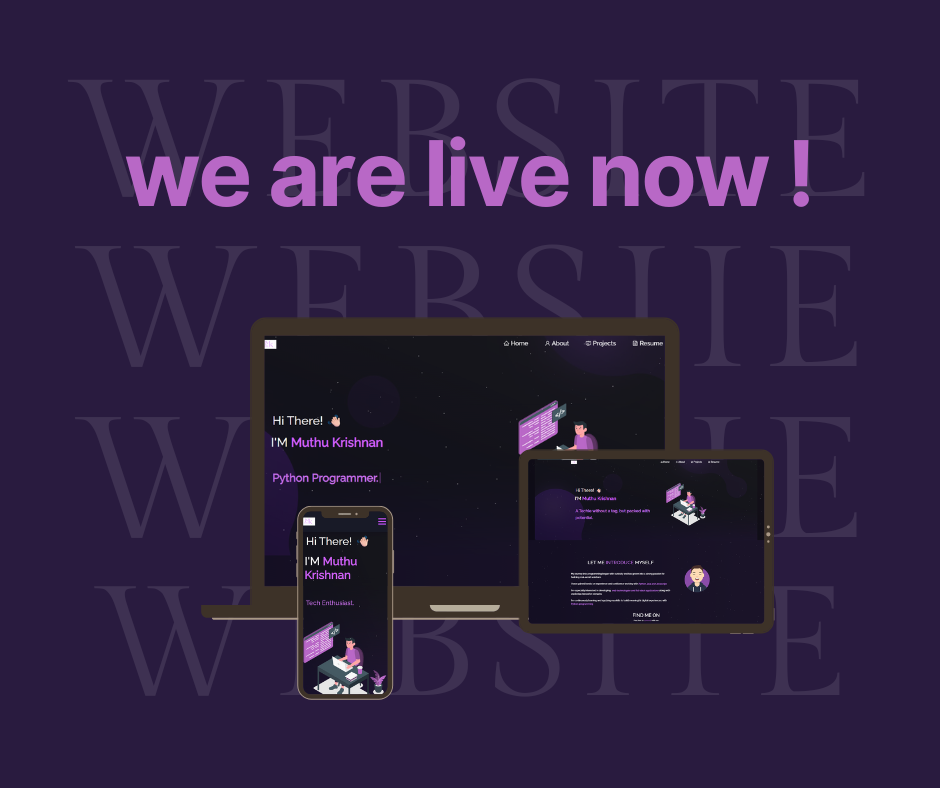
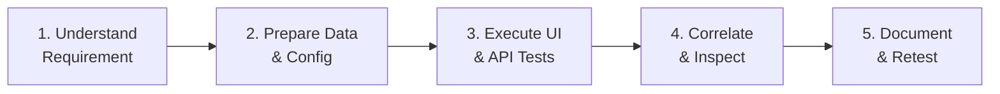

<div align="center">

# Muthu Krishnan | QA Engineer Portfolio

### *I test beyond the happy path — validating workflows, investigating API behavior, and turning unexpected results into actionable insights.*

<p align="center">
  <a href="https://muthukrishnan-portfolio.vercel.app/">
    
  </a>
</p>

[](https://muthukrishnan-portfolio.vercel.app/)
[](https://talview.com)
[](https://muthukrishnan-portfolio.vercel.app/about)
[](https://muthukrishnan-portfolio.vercel.app/project)
[](https://muthukrishnan-portfolio.vercel.app/project)
[](https://muthukrishnan-portfolio.vercel.app/)

<br/>



</div>

---

## 📑 Table of Contents

- [About The Portfolio](#-about-the-portfolio)
- [Professional Profile](#-professional-profile)
- [Featured Case Study: GraphQL Errors Behind HTTP 200](#-featured-case-study)
- [Core Product Domains](#-core-product-domains)
- [QA Methodology & Data Workflow](#-qa-methodology--data-workflow)
- [Technical Skills & Toolstack](#-technical-skills--toolstack)
- [Project Architecture](#-project-architecture)
- [Getting Started Locally](#-getting-started-locally)
- [Connecting & Socials](#-connect--socials)

---

## 🔍 About The Portfolio

This repository hosts the source code for my personal portfolio website, built with **React.js** and styled with custom responsive **CSS3** in a sleek, dark cyberpunk purple aesthetic (`#c770f0` / `#be50f4`).

The portfolio highlights my transition and growth from computer science graduate to a **Quality Assurance Engineer** at **Talview**, demonstrating hands-on expertise in:
- Validating complex web application flows across candidates, interviewers, and recruiters.
- Performing in-depth GraphQL / Hasura query and mutation testing.
- Uncovering edge cases where HTTP 200 OK masks critical backend exceptions.
- Executing 300+ test cases weekly and filing high-impact defect reports in Linear.

---

## 💼 Professional Profile

```yaml
Name: Muthu Krishnan R
Current Role: QA Engineer
Company: Talview
Domains: Payment, Assessment, Proctoring, Interview & Scheduling
Education: B.Sc. Computer Science · Sathyabama University (GPA: 7.12 / 10.0)
Location: Bangalore, India
```

### Day-to-Day Responsibilities:
- **Functional & Manual Testing:** Requirements validation, positive/negative boundary testing, and workflow state transitions.
- **API & GraphQL Testing:** Validating Hasura schemas, variables, role-based authorization headers, and response integrity.
- **End-to-End Workflow Validation:** Cross-service testing across candidate enrollment, scheduling, proctoring, and payment gateways.
- **Defect Investigation & Reporting:** Detailed reproducible bug logs with preconditions, steps, expected vs. actual results, and payload traces using **Linear**.
- **Regression & Release Validation:** Change impact analysis, build verification, and release sign-offs.

---

## 🧪 Featured Case Study

### *Investigating GraphQL Errors Behind HTTP 200 Responses*
> **Domain:** API Testing · GraphQL / Hasura · Negative Testing

#### The Problem
In standard REST, HTTP status codes communicate failure (`4xx`, `5xx`). In GraphQL, requests frequently return **`HTTP 200 OK`** even when execution fails or returns schema validation errors. Relying solely on status codes causes test automation and manual checks to pass false positives.

```http
HTTP/1.1 200 OK  <-- Deceptive Transport Status
Content-Type: application/json

{
  "errors": [
    {
      "message": "variable 'candidate_id' not found in type: 'String!'",
      "extensions": { "code": "validation-failed" }
    }
  ],
  "data": null
}
```

#### Investigation Approach
1. **Execute Baseline Request:** Run queries/mutations with valid inputs to confirm expected response shape.
2. **Inspect Status & Payload Simultaneously:** Validate both the HTTP status and the `data`/`errors` arrays.
3. **Isolate Inputs:** Incrementally test missing required arguments, null values, and invalid UUIDs.
4. **Verify Schema Contract:** Contrast responses against Hasura schema definitions and permissions.
5. **Document Contract Discrepancy:** File structured defects with full payloads and reproduction steps.

---

## 🏛️ Core Product Domains

| Domain | Focus Areas | Key Testing Activities |
| :--- | :--- | :--- |
| 💳 **Payment Services** | Transactions, Invoices, Taxes, Coupons | Validating payment gateway integrations, webhook listeners, checkout flows, and UI vs. backend calculation parity. |
| 📝 **Assessment & Proctoring** | Candidate Journeys, Timer, Question Sets | Verifying question delivery, proctoring permissions, candidate video streams, cheating flags, and submission triggers. |
| 📅 **Scheduling Engine** | Multi-Timezone, Booking, Rescheduling | Validating slot availability, recurring interview occurrences, UTC-to-local timezone conversions, and double-booking locks. |
| 🔌 **Backend & Hasura APIs** | GraphQL Queries, Mutations, Subscriptions | Schema contract testing, role-based access control (RBAC), missing headers, and negative test scenarios. |

---

## 🔄 QA Methodology & Data Workflow



- **Test Data Preparation:** Configuring tenants, users, roles, and test transactions.
- **Response Analysis:** Deep inspection of nested payload objects and error extensions.
- **Data Consistency:** Validating that UI state strictly matches the backend data store.
- **Timezone Validation:** Testing date boundaries across UTC and international local times.
- **Traceability:** Mapping test cases, defects in Linear, and user acceptance criteria.

---

## 🛠️ Technical Skills & Toolstack

### Technical Skills
- **Testing:** Manual Testing, Functional Testing, Regression, Smoke, Sanity, Negative Testing, E2E Testing, Release Validation
- **APIs & Backend:** GraphQL, Hasura Engine, REST APIs, JSON Schema, Request/Response Payloads
- **Programming Languages:** Python, Java, JavaScript, SQL, HTML5, CSS3
- **Automation (In Progress):** Playwright, Puppeteer, Selenium, Page Object Model (POM)

### Tools & Platforms
| Category | Tools |
| :--- | :--- |
| **API Clients** | Postman, Bruno, Chrome DevTools |
| **Issue Tracking** | Linear |
| **Test Management** | TestRail, Tuskr |
| **Version Control & DevOps** | Git, GitHub, Docker, Linux, AWS |
| **Editor** | VS Code, Windows Terminal |

---

## 📂 Project Architecture

```plaintext
my-portfolio/
├── public/
│   ├── favicon.png
│   └── index.html               # SEO metadata & OpenGraph tags
├── src/
│   ├── Assets/
│   │   ├── Projects/            # Domain illustrations & screenshots
│   │   ├── Muthu WD resume.pdf  # Updated 3-page QA Resume
│   │   └── avatar.svg
│   ├── components/
│   │   ├── About/               # Responsibilities, Data Workflow & Skills
│   │   ├── Home/                # Hero section, Current Role Card, Taglines
│   │   ├── Projects/            # Featured GraphQL Case Study & Domain Cards
│   │   ├── Resume/              # Multi-page PDF viewer & CV download
│   │   ├── Navbar.js
│   │   └── Footer.js
│   ├── App.js                   # Client-side routing with React Router
│   └── style.css                # Custom dark theme with neon purple accents
├── Images/                      # Readme previews and media
├── LICENSE
├── package.json
└── README.md
```

---

## 💻 Getting Started Locally

### Prerequisites
- [Node.js](https://nodejs.org/) (v16 or higher)
- [Git](https://git-scm.com/)

### Installation & Run

```bash
# 1. Clone the repository
git clone https://github.com/Muthukrishnan-R/my-portfolio.git

# 2. Navigate to project root
cd my-portfolio

# 3. Install dependencies
npm install --legacy-peer-deps

# 4. Start local development server
npm start
```

Visit **`http://localhost:3000`** in your browser.

### Production Build
```bash
npm run build
```

---

## 📬 Connect & Socials

<div align="center">

[](https://www.linkedin.com/in/muthu-krishnan-6135ab322/)
[](https://github.com/Muthukrishnan-R)
[](mailto:mkmuthu245@gmail.com)
[](https://muthukrishnan-portfolio.vercel.app/)

<br/>

*Designed & Maintained by **Muthu Krishnan R** · © 2026*

